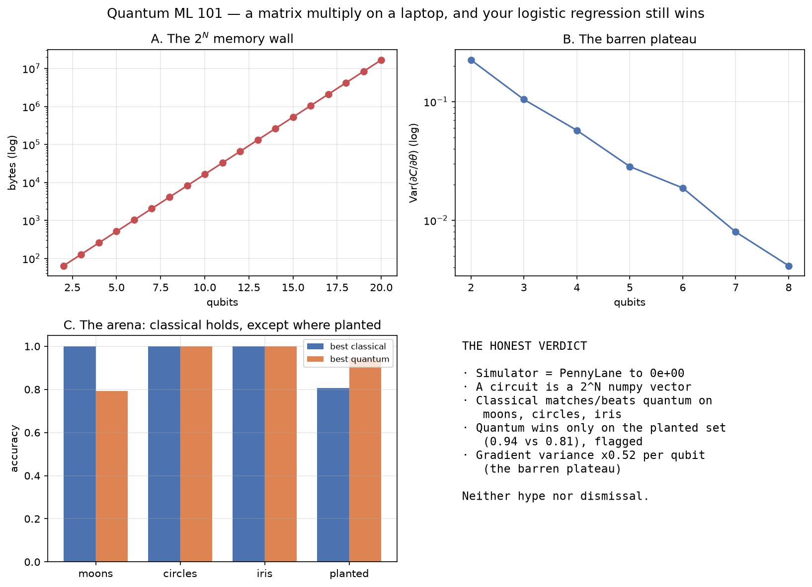

# quantum_ml_101

### It's a Matrix Multiply on a Laptop, and Your Logistic Regression Still Wins

A hands-on, **hype-free** introduction to quantum machine learning, built entirely on CPU
with free, keyless, open-source simulators — **no quantum hardware, no cloud, no account, no
API key**. Everything runs inside a 2-CPU / 8 GB GitHub Codespace.



## The thesis — three claims, each one measured

1. **A quantum circuit is linear algebra.** `N` qubits are a `2^N` vector of complex
   amplitudes; each gate is a unitary matrix; measurement is the Born rule (`|amp|²`). The
   from-scratch numpy simulator agrees with PennyLane **to machine precision (0.0)**.
2. **Classical wins on runnable data.** On moons, circles, and iris, logistic regression and an
   RBF-kernel SVM match or beat the quantum-kernel SVM and the variational quantum circuit
   (VQC), at a fraction of the cost. The only set where the quantum kernel wins
   (**0.94 vs 0.81**) was *engineered* to fit its feature map — shown, and flagged as a caveat.
3. **The barren plateau is why deep VQCs don't train.** The gradient variance collapses
   **~0.52× per qubit** (a 54× drop over 2→8 qubits) until the optimizer has nothing to follow.
   A proven property of the landscape, not a bug.

The verdict is neither hype nor dismissal: every quantum model is put in an **arena** next to a
real classical baseline on accuracy *and* runtime.

## What's inside

Six notebooks, each a build plus a measurement:

| Notebook | Idea | Headline result |
|---|---|---|
| [01 · A Qubit Is a Vector](notebooks/01_a_qubit_is_a_vector.ipynb) | qubit = 2-vector, gate = matrix, Born rule | from-scratch == PennyLane to `0.0` |
| [02 · Circuits and Entanglement](notebooks/02_circuits_and_entanglement.ipynb) | tensor products, Bell state, the `2^N` wall | Bell purity `0.5`; 16 MB @ 20q → 17 TB @ 40q |
| [03 · Feature Maps and Kernels](notebooks/03_feature_maps_and_kernels.ipynb) | a quantum kernel is a kernel → sklearn SVM | classical matches/beats; planted exception flagged |
| [04 · Variational Circuits](notebooks/04_variational_circuits.ipynb) | the quantum neural net, trained by gradient descent | parameter-shift == finite-diff to `2e-9` |
| [05 · The Barren Plateau](notebooks/05_the_barren_plateau.ipynb) | why you can't scale up | variance `×0.52` per qubit (exponential) |
| [06 · Decision Framework](notebooks/06_decision_framework.ipynb) | what's real vs hype, always run the baseline | reads 01–05 and writes the verdict |

Plus a `src/` library (from-scratch simulator, feature maps, quantum kernels, VQC, classical
baselines, barren-plateau and scaling analyses, the arena) and a four-tab **Streamlit app**
(statevector explorer, arena, barren-plateau meter, simulation wall).

Every figure is saved to [`outputs/figures/`](outputs/figures/) as PNG and every
textual/numerical result to [`outputs/data/`](outputs/data/) as JSON.

## Quickstart

```bash
make setup       # install uv, sync deps (all local, keyless), register the Jupyter kernel
make test        # 8 asserted correctness checks
make notebooks   # execute all six notebooks (< 5 min each)
make run         # launch the Streamlit app on :8501
make ci          # sync + lint (ruff + ty) + test
```

Requires Python 3.11+ and [`uv`](https://docs.astral.sh/uv/). No GPU, no QPU, no registration.

## Project layout

```
config/settings.yaml   qubit counts, depths, datasets, seeds
src/sim/               from-scratch statevector simulator + PennyLane validation
src/qml/               feature maps, quantum kernels, VQC + parameter-shift training
src/classical/         logistic, RBF-SVM, small MLP — the yardstick
src/analysis/          barren-plateau and 2^N-scaling measurements
src/datasets/          moons, circles, iris-2d + a planted "quantum-friendly" set
src/evaluation/        the quantum-vs-classical arena
app/streamlit_app.py   interactive explorer
notebooks/             01–06
outputs/figures/*.png  every figure
outputs/data/*.json    every number and caption
tests/                 statevector, kernel, VQC, barren plateau
```

## Why no hardware

A statevector is `2^N` complex128 numbers at 16 bytes each — memory doubles with every qubit
(~16 MB at 20 qubits, ~1 GB at 26, more than exists on Earth at 40), so only small circuits are
classically simulable, and small is enough to learn everything that matters. PennyLane +
`pennylane-lightning` and Qiskit + Aer both run locally with no account; the from-scratch
simulator needs only numpy. Real-hardware access (QPUs, queues, device noise) needs an account
and is deliberately out of scope.

## Related projects

This project carries ideas from other hands-on, CPU-only `_101` builds by the same author into a
quantum setting, with the honest comparison as the new material:

- **[kernels_101](https://github.com/Dima806/kernels_101)** — A hands-on introduction to the
  single most elegant trick in machine learning, built from scratch on CPU. *A quantum kernel is
  a kernel; the kernel trick plugs straight into an SVM, unchanged (NB 03).*
- **[gradient_descent_101](https://github.com/Dima806/gradient_descent_101)** — A hands-on,
  fully visual introduction to the optimization algorithm underneath every model you train,
  built from a two-line update rule up to Adam. *A VQC is trained by exactly this (NB 04).*
- **[backprop_101](https://github.com/Dima806/backprop_101)** — A hands-on introduction to the
  algorithm that trains every neural network on Earth, built from scratch on CPU with no
  deep-learning framework. *The parameter-shift rule stands in for backprop (NB 04).*
- **[curse_of_dimensionality_101](https://github.com/Dima806/curse_of_dimensionality_101)** — A
  hands-on introduction to the single most under-appreciated fact in machine learning, that
  distance stops meaning anything as dimensions grow, built in pure Python on CPU. *The `2^N`
  state space is that exponential (NB 02).*
- **[metrics_101](https://github.com/Dima806/metrics_101)** — A hands-on introduction to the
  numbers everyone reports and few can defend, built from a confusion matrix up through
  precision, recall, F1, ROC AUC, PR AUC, log loss, and Matthews correlation, all on CPU. *The
  honest arena needs a real baseline and a fair metric.*

## References

- Havlíček et al. (2019), *Supervised learning with quantum-enhanced feature spaces*, Nature — quantum kernels.
- Schuld & Killoran (2019), *Quantum machine learning in feature Hilbert spaces*, PRL.
- McClean et al. (2018), *Barren plateaus in quantum neural network training landscapes*, Nat. Commun.
- Huang et al. (2021), *Power of data in quantum machine learning*, Nat. Commun.
- Bergholm et al. (2022), *PennyLane*, arXiv:1811.04968.

## License

Apache-2.0.
